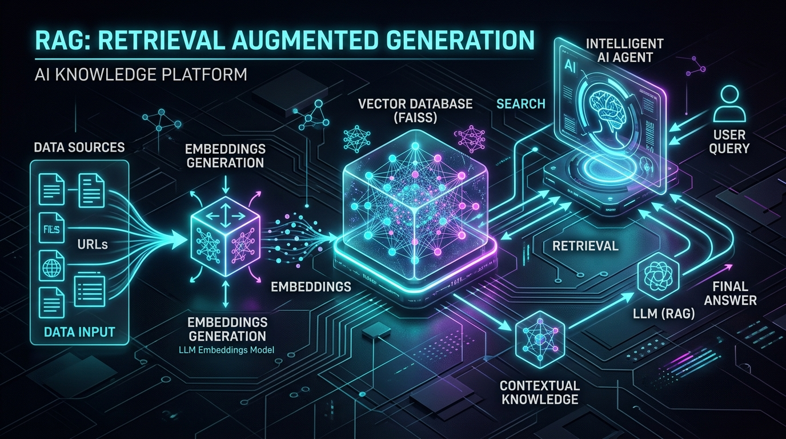

# 🧠 LangChain PoC — Guia de Estudos e RAG Pipeline

<div align="center">
  
  <br/><br/>
  <p><strong>Prova de Conceito (PoC) e laboratório prático explorando LangChain, LangGraph, RAG (Retrieval-Augmented Generation), FAISS e OpenAI/Gemini.</strong></p>
</div>

---

## 📌 Visão Geral do Projeto

Este repositório documenta a evolução prática do aprendizado com **LangChain**:
1. **Chat Models & Streaming**: Invocação básica, mensagens estruturadas (`SystemMessage`, `HumanMessage`, `AIMessage`) e streaming de tokens.
2. **Function Calling & Custom Tools**: Criação de ferramentas com o decorator `@tool` para cálculo de IMC e busca semântica.
3. **Agentes Inteligentes (`create_agent`)**: Orquestração autônoma do ciclo ReAct (*Reasoning + Action*).
4. **Structured Outputs (Pydantic)**: Extração de dados fortemente tipados com `response_format`.
5. **Memória de Conversação (`InMemorySaver`)**: Manutenção de histórico multi-turn baseado em `thread_id`.
6. **Pipeline RAG Completo**: Ingestão de CSV com `CSVLoader`, divisão de texto em chunks com `RecursiveCharacterTextSplitter`, geração de vetores semânticos com `OpenAIEmbeddings`, armazenamento e busca vetorial com `FAISS` e agente consultor de catálogo.

---

## 🏗️ Arquitetura do Pipeline RAG (`main.py`)

```mermaid
graph TB
    subgraph "📥 FASE 1: Ingestão de Dados"
        A["📄 products.csv"] -->|CSVLoader| B["📋 10 Documents"]
        B -->|RecursiveCharacterTextSplitter| C["📦 10 Chunks"]
    end

    subgraph "🧮 FASE 2: Indexação Vetorial"
        C -->|OpenAIEmbeddings| D["🔢 Vetores Numéricos (1536 dim)"]
        D -->|FAISS.from_documents| E["🗄️ Vector Store FAISS (RAM)"]
    end

    subgraph "🔍 FASE 3: Busca & Ferramenta"
        E -->|as_retriever (k=3)| F["🔎 Retriever"]
        F --> G["🔧 @tool search_products"]
    end

    subgraph "🤖 FASE 4: Agente ReAct"
        G --> H["🤖 Agente ReAct<br/>create_agent(gpt-4o-mini)"]
        I["❓ Pergunta do Usuário"] --> H
        H -->|"Chama a tool se necessário"| G
        G -->|"Retorna dados reais do catálogo"| H
        H --> J["💬 Resposta Fundamentada e com Preços"]
    end
```

---

## 🚀 Como Executar o Projeto

### 1. Pré-requisitos
- [Python 3.10+](https://www.python.org/)
- Gerenciador de pacotes [`uv`](https://docs.astral.sh/uv/)

### 2. Configurar Variáveis de Ambiente
Copie o template de variáveis de ambiente e preencha com suas chaves de API:

```bash
cp .env.example .env
```

Edite o arquivo `.env`:
```env
OPENAI_API_KEY=sk-...
GOOGLE_API_KEY=AIzaSy...
```

### 3. Instalar Dependências e Executar
O `uv` sincroniza o ambiente virtual automaticamente:

```bash
uv run python main.py
```

---

## 🛠️ Tecnologias e Bibliotecas Utilizadas

| Componente | Biblioteca / Modelo | Finalidade |
| :--- | :--- | :--- |
| **Gerenciador** | `uv` | Gerenciamento ultrarrápido de dependências e ambiente virtual |
| **Orquestração** | `langchain` / `langchain-core` | Tipos base, mensagens, agentes e integrações |
| **Agentes** | `langgraph` / `langgraph-prebuilt` | Motor de fluxo de agentes ReAct (`create_agent`) e memória |
| **Document Loaders** | `langchain-community (CSVLoader)` | Leitura e conversão de arquivos CSV em `Document`s |
| **Text Splitters** | `langchain-text-splitters` | Divisão inteligente de textos em chunks com overlap |
| **Embeddings** | `langchain-openai (text-embedding-3-small)` | Transformação de texto em vetores de 1536 dimensões |
| **Vector Store** | `faiss-cpu` | Busca por similaridade vetorial em memória (Meta AI) |
| **LLMs Suportados** | `gpt-4o-mini` / `gemini-2.5-flash` | Modelos de raciocínio e geração da resposta final |
| **Schema Validation** | `pydantic` | Validação de tipagem e saídas estruturadas |

---

## 📖 Artigo e Documentação Detalhada

Para uma explicação detalhada linha a linha de cada bloco do código, tabelas comparativas de Vector Stores, ciclo ReAct e guia didático para estudo, consulte:
👉 **[Guia Completo: RAG Passo a Passo (`rag_guide_main_py.md`)](file:///rag_guide_main_py.md)**

---

## 📂 Estrutura de Arquivos

```text
├── assets/
│   └── banner.jpg          # Imagem ilustrativa do pipeline RAG
├── main.py                 # Pipeline RAG completo com Agente ReAct e FAISS
├── products.csv            # Catálogo de produtos para o teste de RAG
├── rag_guide_main_py.md    # Artigo completo com explicações didáticas e diagramas
├── pyproject.toml          # Definições de dependências do projeto
├── uv.lock                 # Lockfile com as versões fixadas
├── .env.example            # Template de variáveis de ambiente
└── README.md               # Este arquivo
```
