# 🧠 Guia Completo: RAG com LangChain — Entendendo o `main.py` Passo a Passo

> Este artigo explica linha por linha o arquivo [`main.py`](file:///c:/Users/paulm/OneDrive/Ambiente%20de%20Trabalho/PROJETOS/langchain-poc/main.py) do projeto **langchain-poc**, que implementa um pipeline completo de **RAG (Retrieval-Augmented Generation)** com um agente inteligente que consulta um catálogo de produtos.

---

## 📌 O que é RAG? (A Grande Ideia)

**RAG** significa **Retrieval-Augmented Generation** (Geração Aumentada por Recuperação).

O problema que ele resolve é simples: **LLMs como o GPT-4 ou Gemini não conhecem os seus dados privados** (seu catálogo de produtos, documentos internos, base de conhecimento, etc.). O RAG resolve isso em 3 passos:

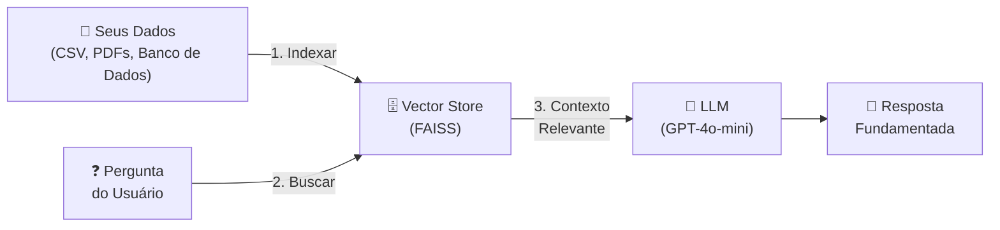

**Em vez de o modelo inventar (alucinar), ele consulta os dados reais antes de responder.**

---

## 🏗️ Arquitetura Completa do Pipeline

O arquivo `main.py` implementa o seguinte fluxo completo:

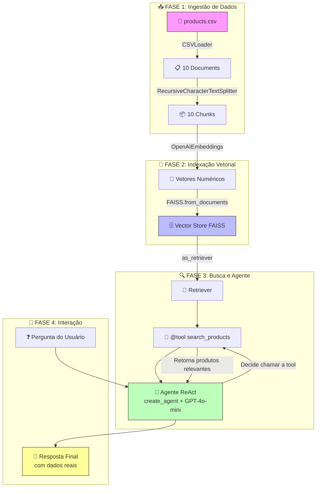

---

## 📖 Explicação Linha por Linha

### 🔌 Bloco 1: Imports (Linhas 1-9)

```python
from dotenv import load_dotenv                              # Carrega variáveis do arquivo .env
from langchain_community.document_loaders import CSVLoader   # Lê arquivos CSV como Documents
from langchain_text_splitters import RecursiveCharacterTextSplitter  # Divide textos grandes em pedaços
from langchain_openai import OpenAIEmbeddings                # Converte texto em vetores numéricos
from langchain_community.vectorstores import FAISS           # Banco de dados vetorial em memória
from langchain.tools import tool                             # Decorator para criar ferramentas
from langchain.agents import create_agent                    # Cria um agente ReAct inteligente
from langchain.messages import HumanMessage                  # Tipo de mensagem do usuário
load_dotenv()                                                # Ativa as chaves de API do .env
```

#### O que cada biblioteca faz:

| Biblioteca | O que faz | Analogia |
| :--- | :--- | :--- |
| `dotenv` | Carrega chaves secretas (API keys) do arquivo `.env` | A chave do cofre |
| `CSVLoader` | Lê um arquivo CSV e transforma cada linha em um `Document` | O leitor de planilha |
| `RecursiveCharacterTextSplitter` | Divide textos longos em pedaços menores (chunks) | A tesoura inteligente |
| `OpenAIEmbeddings` | Transforma texto em vetores numéricos (coordenadas no espaço) | O tradutor de texto → números |
| `FAISS` | Armazena vetores e busca os mais similares entre si | A biblioteca com GPS |
| `@tool` | Transforma uma função Python em uma ferramenta que o LLM pode chamar | O crachá de identificação |
| `create_agent` | Cria um agente que decide autonomamente quando usar as ferramentas | O gerente que delega tarefas |
| `HumanMessage` | Representa uma mensagem enviada pelo usuário humano | O envelope com a pergunta |

---

### 📥 Bloco 2: Carregamento do CSV (Linhas 11-15)

```python
loader = CSVLoader(file_path='products.csv', encoding='utf-8')
documents = loader.load()

print(f"Conteúdo do CSV: {len(documents)} linhas")
print(f"Primeiro produto: {documents[0].page_content}")
```

#### O que acontece aqui:

O `CSVLoader` lê o arquivo [`products.csv`](file:///c:/Users/paulm/OneDrive/Ambiente%20de%20Trabalho/PROJETOS/langchain-poc/products.csv) e converte **cada linha** do CSV em um objeto `Document` do LangChain.

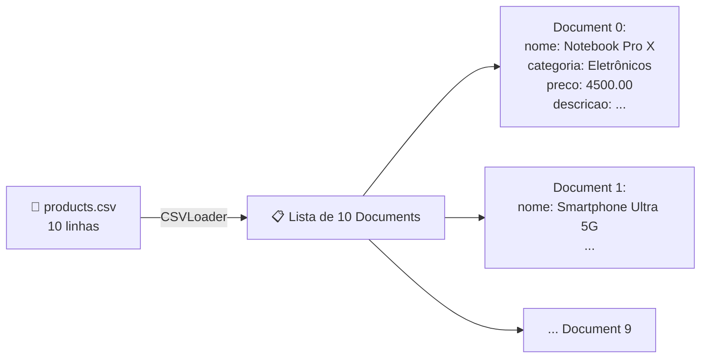

Cada `Document` possui dois campos:
- **`page_content`** (str): O conteúdo textual (ex: `"nome: Notebook Pro X\ncategoria: Eletrônicos\npreco: 4500.00\ndescricao: ..."`)
- **`metadata`** (dict): Dados extras como `{"source": "products.csv", "row": 0}`

> [!NOTE]
> **Por que não usar `pandas.read_csv()` diretamente?**
> Porque o LangChain trabalha com o tipo `Document`. Ele é o formato padrão que todos os componentes (splitters, embeddings, vector stores) entendem. É como a "língua universal" do ecossistema.

---

### ✂️ Bloco 3: Divisão em Chunks (Linhas 17-20)

```python
text_splitter = RecursiveCharacterTextSplitter(chunk_size=500, chunk_overlap=50)
chunks = text_splitter.split_documents(documents)

print(f"Chunks criados: {len(chunks)}")
```

#### O que acontece aqui:

O `RecursiveCharacterTextSplitter` pega cada `Document` e tenta dividir em pedaços menores de no máximo 500 caracteres, com 50 caracteres de sobreposição entre eles.

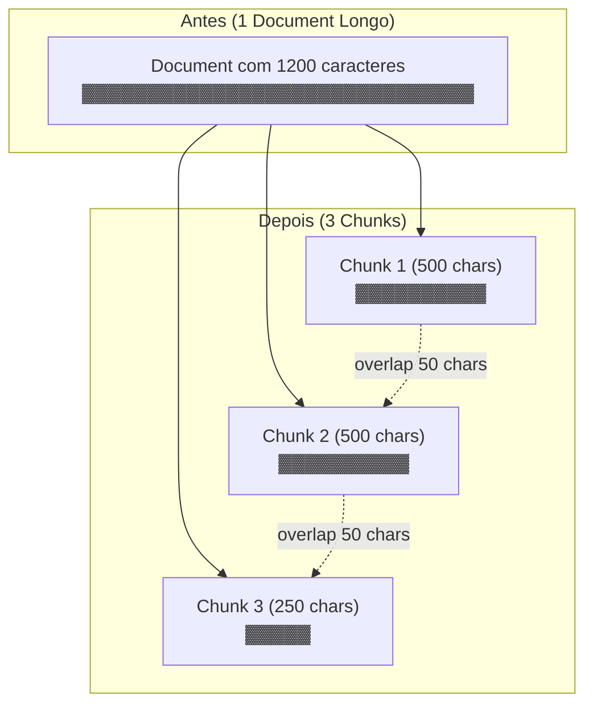

#### Por que dividir?

| Parâmetro | Valor | Motivo |
| :--- | :--- | :--- |
| `chunk_size=500` | Máx. 500 caracteres por pedaço | LLMs têm limite de contexto e chunks menores são mais precisos na busca |
| `chunk_overlap=50` | 50 caracteres compartilhados | Evita cortar uma frase no meio e perder contexto entre pedaços vizinhos |

> [!TIP]
> **No nosso caso**, como cada produto do CSV já é curto (menos de 500 chars), os 10 Documents viraram 10 Chunks sem divisão. Mas se você tivesse descrições enormes (como artigos de blog, contratos ou manuais), o splitter dividiria cada um em vários pedaços.

#### O nome "Recursive" (Recursivo) vem da estratégia:
Ele tenta dividir primeiro por `\n\n` (parágrafos), depois por `\n` (linhas), depois por ` ` (espaços) e por último por caractere individual. Vai tentando de forma recursiva até conseguir pedaços do tamanho certo sem quebrar frases.

---

### 🧮 Bloco 4: Embeddings e Vector Store (Linhas 22-25)

```python
embeddings = OpenAIEmbeddings(model="text-embedding-3-small")
vector_store = FAISS.from_documents(chunks, embeddings)

retriever = vector_store.as_retriever(search_kwargs={"k": 3})
```

**Este é o coração do RAG.** Aqui acontece a "mágica" que permite buscar por significado.

#### Passo 4.1: Embeddings — Transformando texto em números

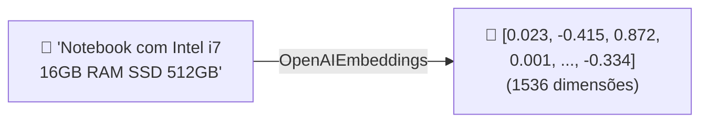

**O que é um Embedding?**
É uma representação numérica (vetor) do significado semântico de um texto. Textos com significados parecidos ficam com vetores próximos no espaço.

**Modelo usado**: `text-embedding-3-small` da OpenAI
- Produz vetores de **1536 dimensões**
- Cada texto vira uma coordenada num espaço de 1536 dimensões
- É rápido e barato (~$0.02 por 1M de tokens)

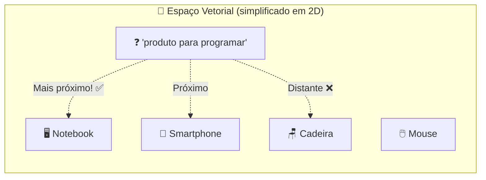

Textos semanticamente similares ficam **próximos** no espaço vetorial:
- "notebook para programar" ↔ "Notebook com Intel i7 para desenvolvedores" → **PRÓXIMOS** ✅
- "notebook para programar" ↔ "Cadeira ergonômica com braços 3D" → **DISTANTES** ❌

#### Passo 4.2: FAISS — O banco de dados vetorial

O **FAISS** (Facebook AI Similarity Search) é uma biblioteca da Meta que armazena esses vetores e realiza buscas de similaridade em milissegundos.

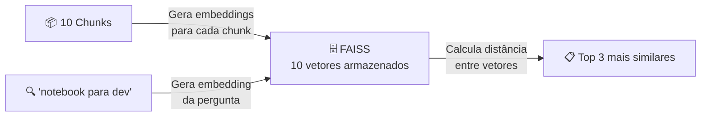

**`FAISS.from_documents(chunks, embeddings)`** faz:
1. Pega cada chunk de texto
2. Envia para a API de embeddings da OpenAI
3. Recebe de volta os 10 vetores numéricos
4. Armazena tudo num índice FAISS em memória (RAM)

#### Passo 4.3: Retriever — O buscador

```python
retriever = vector_store.as_retriever(search_kwargs={"k": 3})
```

O **Retriever** é uma interface padronizada para buscar documentos. O parâmetro `k=3` significa: *"retorne os 3 documentos mais relevantes para a pergunta"*.

---

### 🔧 Bloco 5: A Tool de Busca (Linhas 27-45)

```python
@tool
def search_products(query: str) -> str:
    """Busca produtos no catálogo através de busca semântica.

    Útil quando o usuário pergunta sobre disponibilidade, preço, categoria
    ou características de produtos (como notebooks, teclados, smartphones, etc.).

    Args:
        query (str): Termo de busca ou pergunta sobre os produtos.

    Returns:
        str: Informações dos produtos mais relevantes encontrados.
    """
    docs = retriever.invoke(query)
    if not docs:
        return "Nenhum produto encontrado para a pesquisa"
    
    result = [doc.page_content for doc in docs]
    return "\n\n".join(result)
```

#### O que o `@tool` faz:

O decorator `@tool` pega a sua função Python e converte em uma **ferramenta que o LLM pode decidir usar**. Internamente, ele:

1. Lê o **nome da função** (`search_products`) → vira o nome da tool
2. Lê a **docstring** → vira a descrição que o LLM usa para decidir quando chamá-la
3. Lê os **tipos dos parâmetros** (`query: str`) → vira o JSON Schema dos argumentos
4. Empacota tudo num formato que a API de Function Calling da OpenAI/Google entende

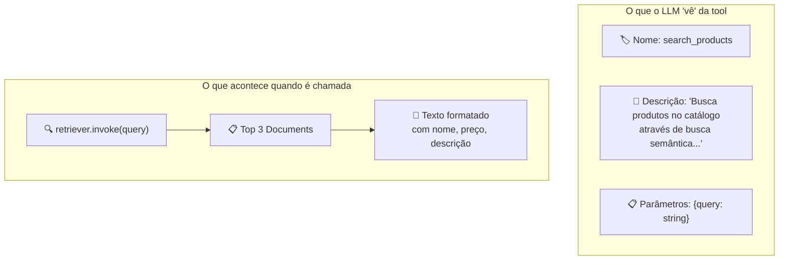

> [!IMPORTANT]
> **A docstring é OBRIGATÓRIA** em ferramentas com `@tool`. Sem ela, o LangChain gera erro. Isso porque o LLM precisa dessa descrição para saber **quando** deve usar a ferramenta. Pense na docstring como o "manual de instruções" que você entrega ao modelo.

---

### 🤖 Bloco 6: O Agente ReAct (Linhas 47-53)

```python
system_prompt = ("Você é um assistente especializado em produtos de tecnologia e escritório. ...")

agent = create_agent(
    model="gpt-4o-mini",
    system_prompt=system_prompt,
    tools=[search_products]
)
```

#### O que é o `create_agent`?

O `create_agent` do LangGraph cria um **Agente ReAct** — um padrão onde o LLM segue um ciclo de **Raciocinar → Agir → Observar**:

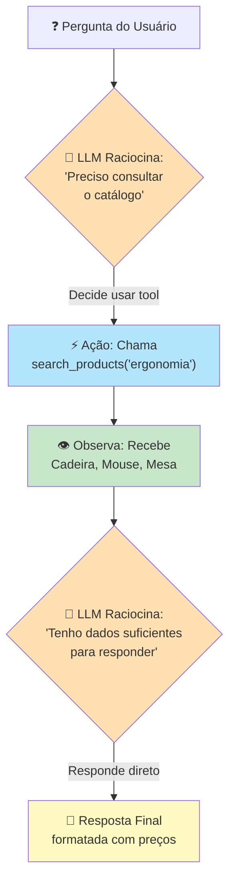

**O ciclo ReAct (Reason + Act):**

| Fase | O que acontece | Exemplo |
| :--- | :--- | :--- |
| **Reason** (Raciocinar) | O LLM analisa a pergunta e decide se precisa de informações externas | *"O usuário perguntou sobre ergonomia, preciso consultar o catálogo"* |
| **Act** (Agir) | O LLM chama a tool `search_products` com os argumentos adequados | `search_products("ergonomia home office")` |
| **Observe** (Observar) | O resultado da tool volta para o LLM como contexto | Recebe: Cadeira R$1200, Mouse R$180, Mesa R$2300 |
| **Respond** (Responder) | Com os dados reais em mãos, o LLM formula a resposta final | Formata uma lista bonita com preços |

> [!NOTE]
> **Diferença entre `create_agent` e `model.invoke()`**:
> - `model.invoke()`: Você faz tudo manualmente (chama o modelo, executa as tools, reenvia para o modelo...).
> - `create_agent`: O agente faz todo esse ciclo automaticamente. Você só envia a pergunta e recebe a resposta final pronta.

---

### 💬 Bloco 7: Loop de Perguntas (Linhas 55-66)

```python
questions = [
    "quais propdutos voce tem para melhorar a ergonomia do home office?",
    "estou montando um setup gamer, tem algo par arecomendar?",
    "preciso de perifericos sem fio, quais pcoes voces tem?",
    "qual produto mais barato do catalogo?"
]

for question in questions:
    print(f"\n{'=' * 60}")
    print(f"Pergunta: {question}")
    response = agent.invoke({"messages": [HumanMessage(content=question)]})
    print(f"Resposta: {response['messages'][-1].content}")
```

Para cada pergunta, o fluxo completo é executado:

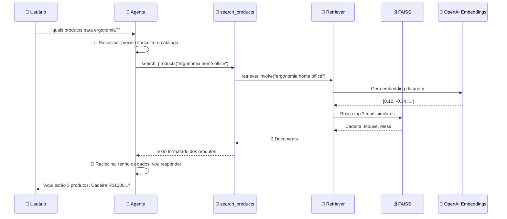

---

## 🗺️ Mapa das Bibliotecas: LangChain vs LangGraph

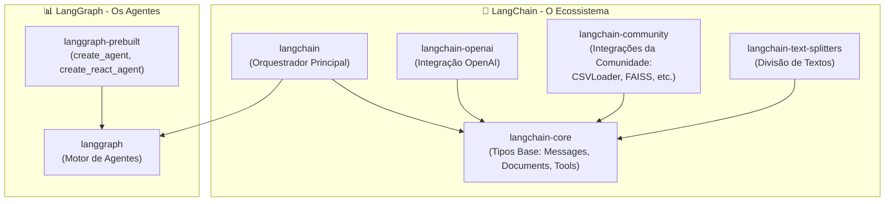

| Pacote | Responsabilidade | Usado no nosso código? |
| :--- | :--- | :--- |
| **`langchain`** | Pacote principal, orquestra tudo | ✅ `create_agent`, `@tool`, `HumanMessage` |
| **`langchain-core`** | Tipos base (Document, Message, Tool) | ✅ (usado indiretamente) |
| **`langchain-openai`** | Integração com OpenAI (modelos + embeddings) | ✅ `OpenAIEmbeddings` |
| **`langchain-community`** | Integrações da comunidade (loaders, vector stores) | ✅ `CSVLoader`, `FAISS` |
| **`langchain-text-splitters`** | Divisão inteligente de textos | ✅ `RecursiveCharacterTextSplitter` |
| **`langgraph`** | Motor de agentes com grafos de estado | ✅ (usado pelo `create_agent`) |
| **`langgraph-prebuilt`** | Agentes prontos (ReAct, etc.) | ✅ `create_agent` |

---

## 🌍 Em que contextos reais este padrão RAG poderia ser usado?

### 1. 🛒 E-commerce (Exatamente o nosso caso!)
- Chatbot de vendas que consulta o catálogo real de produtos
- Recomendação personalizada baseada no que o cliente pergunta
- Suporte ao cliente que busca em FAQs e manuais de produtos

### 2. 📚 Base de Conhecimento Interna
- Assistente que busca em documentações técnicas da empresa
- Chatbot de RH que responde sobre políticas, benefícios e processos
- Suporte técnico que consulta manuais e troubleshooting guides

### 3. ⚖️ Jurídico e Compliance
- Busca em contratos e documentos legais
- Consulta a legislações e normas regulatórias
- Análise de cláusulas contratuais

### 4. 🏥 Saúde
- Consulta em bases de medicamentos e interações
- Busca em prontuários e históricos médicos
- Assistente para protocolos clínicos

### 5. 🎓 Educação
- Tutor que consulta materiais do curso para responder dúvidas
- Assistente que busca em livros e artigos acadêmicos

---

## 🔧 Outras Tools que poderiam ter sido adicionadas

No nosso agente, usamos apenas a tool `search_products`. Mas poderíamos ampliar com:

```python
@tool
def get_product_by_category(category: str) -> str:
    """Filtra produtos por categoria específica (Eletrônicos, Periféricos, Móveis, Áudio)."""
    # Filtra no DataFrame ou no vector store
    ...

@tool
def calculate_total(product_names: list[str]) -> str:
    """Calcula o preço total de uma lista de produtos selecionados."""
    # Soma os preços dos produtos
    ...

@tool
def compare_products(product_a: str, product_b: str) -> str:
    """Compara dois produtos lado a lado mostrando diferenças de preço e características."""
    ...

@tool
def check_budget(budget: float, category: str) -> str:
    """Verifica quais produtos cabem no orçamento do cliente numa categoria específica."""
    ...

@tool
def search_web(query: str) -> str:
    """Busca informações na internet quando o catálogo não tem a resposta."""
    # Integração com Tavily, Google Search, etc.
    ...
```

Com múltiplas tools, o agente decide **sozinho** qual usar para cada pergunta:

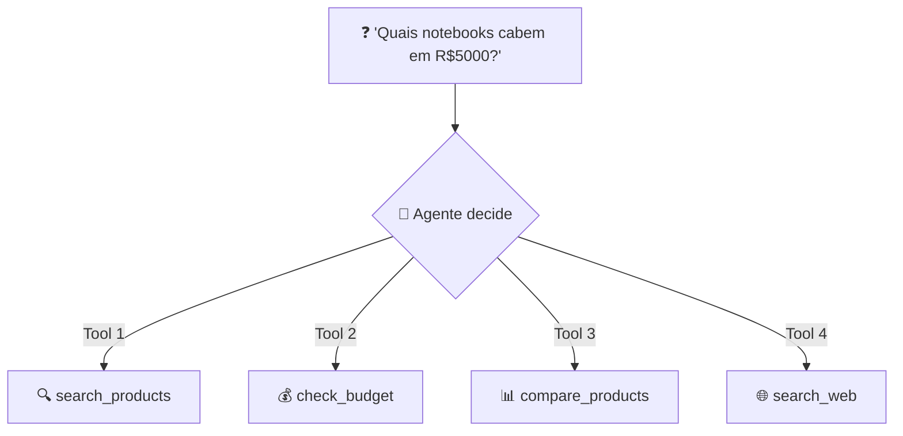

---

## 🔄 Outros Document Loaders disponíveis

Nós usamos o `CSVLoader`, mas o LangChain suporta dezenas de fontes de dados:

| Loader | Fonte | Caso de Uso |
| :--- | :--- | :--- |
| `CSVLoader` | Arquivos CSV | ✅ Catálogos, dados tabulares |
| `PyPDFLoader` | Arquivos PDF | Contratos, manuais, livros |
| `TextLoader` | Arquivos .txt | Logs, textos simples |
| `JSONLoader` | Arquivos JSON | APIs, configurações |
| `DirectoryLoader` | Pasta inteira | Indexar todos os arquivos de uma pasta |
| `WebBaseLoader` | Páginas web (URL) | Crawling de sites e blogs |
| `NotionDBLoader` | Notion | Documentação interna |
| `GitLoader` | Repositório Git | Código-fonte |
| `UnstructuredWordDocumentLoader` | DOCX | Documentos Word |
| `SQLDatabaseLoader` | Banco SQL (PostgreSQL, MySQL) | Dados estruturados em produção |

---

## 🔄 Outros Vector Stores disponíveis

Nós usamos o FAISS (em memória), mas existem opções persistentes:

| Vector Store | Tipo | Quando usar |
| :--- | :--- | :--- |
| **FAISS** | Em memória (RAM) | ✅ Desenvolvimento, protótipos, dados pequenos |
| **Chroma** | Local (disco) | Projetos pequenos/médios com persistência |
| **Pinecone** | Nuvem (SaaS) | Produção, escalabilidade, milhões de vetores |
| **Weaviate** | Nuvem/Self-hosted | Produção com busca híbrida |
| **Qdrant** | Nuvem/Self-hosted | Alta performance, filtros avançados |
| **pgvector** | PostgreSQL | Quando já usa PostgreSQL em produção |
| **Supabase** | PostgreSQL (SaaS) | Integração com Supabase |

---

## 📋 Resumo: Glossário Rápido

| Termo | Definição Simples |
| :--- | :--- |
| **RAG** | Padrão onde o LLM busca dados reais antes de responder |
| **Document** | Objeto LangChain com `page_content` (texto) e `metadata` |
| **Chunk** | Pedaço menor de um Document, otimizado para busca |
| **Embedding** | Representação numérica (vetor) do significado de um texto |
| **Vector Store** | Banco de dados que armazena e busca vetores por similaridade |
| **Retriever** | Interface que busca Documents relevantes para uma query |
| **Tool** | Função Python que o LLM pode decidir chamar automaticamente |
| **Agent** | LLM + ferramentas que raciocina e age autonomamente |
| **ReAct** | Padrão Reason + Act: raciocinar → agir → observar → responder |
| **FAISS** | Biblioteca da Meta para busca vetorial ultrarrápida |
| **Similarity Search** | Encontrar os vetores mais próximos (= textos mais semelhantes) |
| **Function Calling** | Recurso da API OpenAI/Google que permite o LLM chamar funções |

---

## 🎯 O que estudar em seguida?

1. **Conversation Memory com RAG**: Adicionar `InMemorySaver` para o agente lembrar do contexto entre perguntas
2. **Multi-tool Agent**: Criar agente com várias tools (busca, cálculo, comparação)
3. **Streaming**: Usar `agent.stream()` para ver as respostas chegando em tempo real
4. **Persistência**: Trocar FAISS (RAM) por Chroma ou pgvector (disco/banco)
5. **Diferentes LLMs**: Testar com Gemini (`model="gemini-2.5-flash"`) e comparar respostas
6. **Avaliação**: Usar LangSmith para avaliar a qualidade das respostas do RAG
